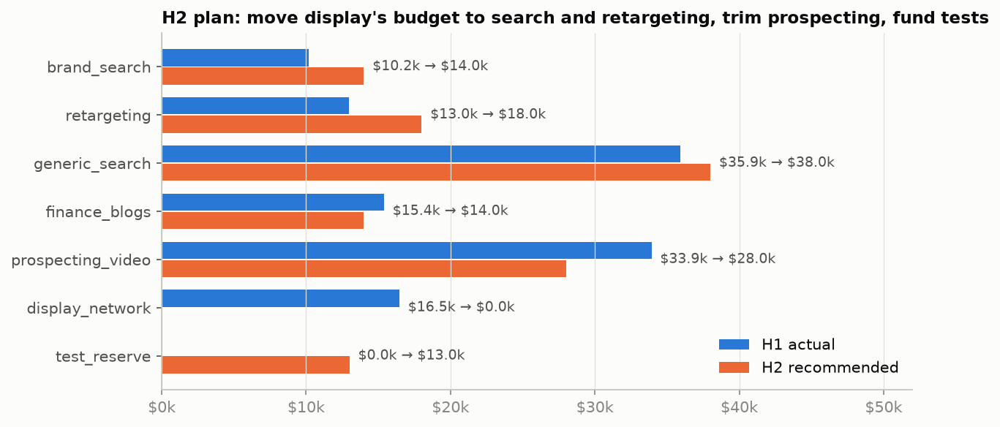
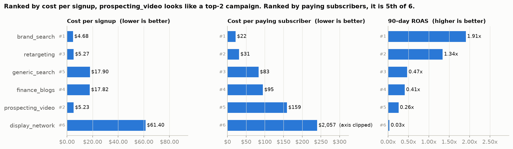
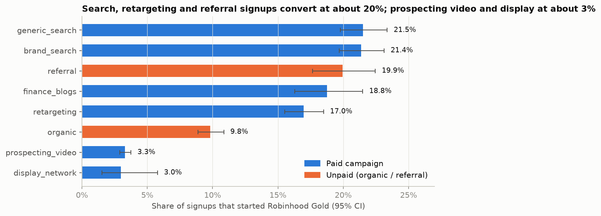
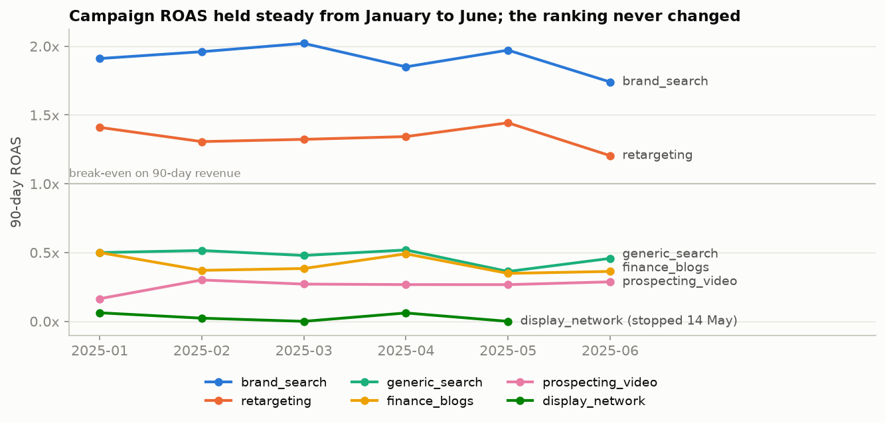

# Marketing Channel Performance: Robinhood, H1 2025

In the first half of 2025, Robinhood's growth team spent **$124,886** on search, social, display and affiliate ads. The CMO is setting the H2 budget and wants to know which channels are worth the money. This repo connects six months of ad spend to signups, Robinhood Gold subscribers and first-90-day revenue. It then recommends an H2 budget split.

## Recommendation

**Judge channels on cost per paying subscriber, not cost per signup.** Free accounts earned $0 in this data. Only Gold subscribers make money.

For H2, keep the budget flat at about **$125k**:

| Campaign | H1 spend | H2 budget | Change | Why |
|---|---:|---:|---:|---|
| brand_search | $10.2k | **$14.0k** | +37% | Lowest cost per paying sub ($22), 1.91x ROAS. Capped by brand query volume. |
| retargeting | $13.0k | **$18.0k** | +39% | $31 per paying sub, 1.34x ROAS. |
| generic_search | $35.9k | **$38.0k** | +6% | Best channel for new demand at scale: 21.5% of signups convert, $83 per paying sub. |
| finance_blogs | $15.4k | **$14.0k** | -9% | $95 per paying sub. Renegotiate toward cost-per-subscriber terms. |
| prospecting_video | $33.9k | **$28.0k** | -17% | $159 per paying sub and 3.3% conversion. Trim it but keep it, because it feeds the retargeting pool. Optimise bidding for Gold starts. |
| display_network | $16.5k | **$0** | -100% | $2,057 per paying sub, 0.03x ROAS. It already stopped on 14 May; keep it off. |
| Test reserve | - | **$13.0k** | new | Holdout tests on brand search and retargeting, plus prospecting creative tests. |

If H1 average costs held, this plan would bring about **2,000 paying subscribers from paid media, up from 1,698**. That is an upper bound (see Risks).



## Key findings

**1. The cheapest campaign per signup is not the cheapest per paying subscriber.**
- At channel level, Paid Social is the cheapest per signup ($5.24, against $11.02 for Paid Search). It is 44% more expensive per paying subscriber ($74 against $51).
- At campaign level, prospecting_video is the 2nd cheapest per signup ($5.23) but 5th of 6 per paying subscriber ($159). It brought 34% of all signups and only 9% of paying subscribers.
- generic_search and finance_blogs look expensive per signup (about $18). Each paying subscriber they bring costs roughly half as much as one from prospecting.



**2. Intent matters more than paid vs unpaid.**
- Paid signups as a whole convert to Gold at 11.9%, against 9.8% for organic. The average hides two groups:
  - High-intent campaigns convert at 17-22%, on par with referral (19.9%) and about double organic: generic search, brand search, finance blogs and retargeting.
  - Prospecting video (3.3%) and display (3.0%) convert at about a third of the organic rate.
- Every paid campaign's rate differs from organic at p < 0.001.



**3. Performance was stable over the half; display stopped.**
- display_network has no spend after **14 May 2025**. Over its five months it produced 0 to 4 paying subscribers a month.
- Brand search and retargeting beat break-even on 90-day revenue in every month.
- Generic search, finance blogs and prospecting never broke even within 90 days.
- Generic search softened in May and June: cost per paying sub rose from about $80 to $96 and $85, and CPC crept from $1.60 to $1.68.



## Full campaign metrics

| Campaign | Spend | CTR | CPC | Signups | Paying subs | Signup→paid | Cost / signup | Cost / paying sub | 90-day ROAS |
|---|---:|---:|---:|---:|---:|---:|---:|---:|---:|
| brand_search | $10,197 | 4.51% | $0.84 | 2,177 | 465 | 21.4% | $4.68 | $21.93 | 1.91x |
| retargeting | $12,987 | 1.59% | $0.75 | 2,465 | 418 | 17.0% | $5.27 | $31.07 | 1.34x |
| generic_search | $35,939 | 2.47% | $1.62 | 2,008 | 432 | 21.5% | $17.90 | $83.19 | 0.47x |
| finance_blogs | $15,392 | 1.10% | $1.99 | 864 | 162 | 18.8% | $17.82 | $95.02 | 0.41x |
| prospecting_video | $33,916 | 1.20% | $0.50 | 6,484 | 213 | 3.3% | $5.23 | $159.23 | 0.26x |
| display_network | $16,455 | 0.12% | $2.10 | 268 | 8 | 3.0% | $61.40 | $2,056.83 | 0.03x |
| organic | - | - | - | 3,511 | 345 | 9.8% | - | - | - |
| referral | - | - | - | 1,063 | 212 | 19.9% | - | - | - |

The full tables are in [outputs/](outputs/): [campaign_metrics.csv](outputs/campaign_metrics.csv), [channel_metrics.csv](outputs/channel_metrics.csv), [monthly_metrics.csv](outputs/monthly_metrics.csv) and [budget_plan.csv](outputs/budget_plan.csv).

## Which metric, and why it changes the ranking

| Metric | Ranking (best to worst) |
|---|---|
| Cost per signup | brand_search, **prospecting_video**, retargeting, finance_blogs, generic_search, display |
| Cost per paying subscriber | brand_search, retargeting, generic_search, finance_blogs, **prospecting_video**, display |
| 90-day ROAS | brand_search, retargeting, generic_search, finance_blogs, **prospecting_video**, display |

- **Cost per signup** rewards cheap, low-intent free accounts. On that metric, prospecting video looks like the place to grow.
- **Cost per paying subscriber** counts only users who generate revenue. It is the primary metric used here.
- **90-day ROAS** is the payback check. It is biased toward annual plans, because the full $79.99 lands inside the window while a monthly subscriber shows at most $29.97. It also ignores revenue after day 90.

Paying subscribers and ROAS give the same order. The ranking changes when you move from **signups** to **paying subscribers**.

## Risks

1. **Diminishing returns.** Daily spend was flat all half, so there is no evidence of marginal cost at higher budgets. Brand search is the most capped, because more budget cannot create more searches for "Robinhood". Scale in steps and review monthly.
2. **Incrementality and attribution.**
   - Brand search and retargeting may claim users who would have signed up anyway.
   - Last-touch credit may undervalue prospecting video, which feeds retargeting audiences and brand searches.
   - Cutting prospecting too hard could hurt the campaigns that look best. Hence the moderate 17% cut and the holdout tests.
3. **The 90-day window.** Only brand search and retargeting pay back within 90 days. The case for generic search and finance blogs depends on Gold retention beyond 90 days. Validate it with cohort lifetime value before scaling them further.
4. **Small samples.** Display had 8 paying subscribers and finance blogs about 25 a month, so their monthly figures are noisy.
5. **Seasonality and markets.** Brokerage signups track market activity. H2 conditions may not match H1.

## Data preparation

- **Channel names** differ between the files ("Paid Social" in `ad_spend.csv`, "paid_social" in `signups.csv`). Both were mapped to a shared `channel_key` (lowercase, spaces replaced with underscores). After that, every paid channel/campaign pair matches in both files. `organic` and `referral` appear only in signups.
- **Duplicate spend:** 7 exact duplicate rows ($920.24) were removed before totals were calculated. After that, every campaign-day is unique.
- **Other checks passed:**
  - no nulls in the spend data
  - no negative values
  - no clicks greater than impressions
  - no duplicate users
  - plan and subscription date are always both present or both empty
  - no subscription starts before its signup
  - non-payers have $0 revenue

## Definitions

- **CTR** = clicks / impressions. **CPC** = spend / clicks.
- **Cost per signup** = spend / signups credited to the campaign.
- **Paying subscriber** = a signup with a Gold plan (monthly or annual).
- **Cost per paying subscriber** = spend / paying subscribers.
- **90-day ROAS** = `revenue_first_90_days` summed over the campaign's signups / spend.

## Reproduce

```bash
pip install -r requirements.txt
jupyter nbconvert --to notebook --execute --inplace analysis.ipynb
```

The notebook [analysis.ipynb](analysis.ipynb) reads `ad_spend.csv` and `signups.csv` from the repo root. It writes the tables to `outputs/` and the charts to `figures/`.
